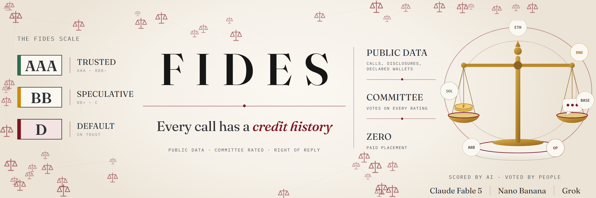

<div align="center">



# FIDES

**Credibility Ratings for Crypto Influencers**

*Every call has a credit history.*

[fidesratings.tech](https://fidesratings.tech) · [@FIDESRatings on X](https://x.com/FIDESRatings)

[](#the-fides-rating-rubric)
[](#tech-stack)
[](#the-fides-rating-rubric)
[](https://github.com/FidesRating/Fides)

</div>

---

FIDES is an independent rating agency for crypto influencers. It rates the public accounts followers rely on, the way agencies rate debt: from public calls, disclosed promotions, and the wallets an influencer declared themselves. The scale runs from **AAA to D**, with an **Outlook** and a **Rating Watch**.

One sentence: *influencers borrow the trust of their followers, and FIDES rates whether they deserve it.*

FIDES ratings are opinions based on public data and a published methodology. They are not statements of fact, not regulated credit ratings, and not investment advice. The scale is modelled on the letter scales used by credit rating agencies; FIDES is not affiliated with any of them.

---

## Why FIDES

Followers act on calls from accounts they cannot check. Follower counts and engagement are easy to buy, and paid promotions are often not disclosed.

FIDES replaces reputation by volume with a rating that can be checked and answered:

* **Public Data Only:** Posts the account itself published, token prices at the time of each call, and wallets the account declared in public or proved with a signature. No private data, no guessed wallets, no wallet clustering.
* **Scorecard, Then Committee:** A server-side scorecard turns four pillars into a 0 – 100 score. A human Rating Committee decides the final rating and may move at most one notch from the scorecard, with a published reason.
* **Right of Reply:** Every rating action is notified to the rated account 48 hours before publication. Claimed accounts can reply on the rating page and appeal once per action within 14 days. Before launch only, the owner can set `PRELAUNCH_MODE=true` on the API to publish without the notice period; removing the variable restores the 48 hour rule.
* **Evidence You Can Inspect:** Every call and every paid promotion keeps its source link, capture time, content hash and the analyst who captured it.
* **Access Is Not Influence:** Holding the $FIDES token opens the FIDES Desk (full data, watchlist, API, tips). It never changes a rating, a score or a committee decision.

---

## Architecture & Pipeline

FIDES follows the process of a rating agency: analysts prepare the scorecard, a committee decides, the rated account is told before publication, and the rating is monitored afterwards.

```
[Coverage Check] ──> [Scorecard] ──> [Rating Committee] ──> [48h Notice] ──> [Published]
   10k+ followers      4 pillars        ≥ 3 votes without       right of           rating, outlook,
   public data         caps · D · NR    conflicts, ±1 notch     reply              rationale, reply
                                                                                       │
                         [Appeal ◄──────────────────────────────────────────────────────┤
                         once, 14 days]                                                 ▼
                                                                          [Surveillance · Rating Watch ≤ 90 days]
```

### Core Components

| Component | Function |
|---|---|
| **Next.js Frontend** | Server-rendered public pages: ratings, rating reports, history, actions, scale, methodology, ethics |
| **Rating Engine** | Pure function (no database) that computes pillar scores, caps, default and Not Rated rules |
| **Admin (Analyst)** | Influencer, social account, call, wallet and promotion intake with price and evidence provenance |
| **Committee** | Votes, conflict declarations, quorum, finalisation, notice, publication and Rating Watch |
| **Claims** | Profile claim, signed wallets, replies and appeals for rated accounts |
| **Public API** | Read-only endpoints that never expose votes, staff identities, member wallets or unconfirmed evidence |
| **Surveillance** | Daily job that flags accounts for review (180 days due, one notch drift, watch past 90 days) |

---

## The FIDES Rating Rubric

Accounts are scored on four pillars (0 – 100 each). The weights add up to 100%.

| Pillar | Weight | What it measures |
|---|---|---|
| **Call Accuracy** | 35% | Price when posted vs 30 days later, against BTC. Hit rate and median excess return |
| **Disclosure** | 25% | Proven paid promotions that were disclosed vs all proven promotions |
| **Wallet Alignment** | 25% | Sales of promoted tokens from self-declared wallets within 7 days of the call |
| **Conduct** | 15% | Calls deleted after posting and promoted projects later proven to be rugs |

```
total = 0.35 × Accuracy + 0.25 × Disclosure + 0.25 × Wallet Alignment + 0.15 × Conduct
```

### Rating Bands

```
AAA  AA+ AA AA−  A+ A A−  BBB+ BBB BBB−  ──►  Trusted grade
BB+ BB BB−  B+ B B−  CCC+ CCC CCC−  CC  C  ──►  Speculative grade
D                                          ──►  Default on trust
NR                                         ──►  Not Rated (fewer than 10 measurable calls)
```

### Automatic Rules (the committee cannot change them)

| Rule | Trigger | Result |
|---|---|---|
| **Not Rated** | Fewer than 10 calls old enough to measure (30 days) | NR, no public score |
| **Default on trust** | One call with a proven undisclosed paid promotion and a verified wallet selling at least 50% within 7 days | D, whatever the score |
| **Rug cap** | Promoted a proven rug in the last 12 months and never withdrew the call | CCC+ at most |
| **Transparency cap** | No verified wallet | A at most |

---

## Data & Evidence Rules

| Used | Never used |
|---|---|
| The account's own public posts, with an archive as proof | Personal data: real name (unless used publicly), address, family, workplace |
| Token prices at the time of the call | Guessing or linking wallets to an account through cluster analysis |
| Wallets declared in a public post or proved with a signature | Wallets "believed" to belong to someone |
| A project's own statement, public invoices, or on-chain payments to a declared wallet | Private messages, leaked data, unverifiable screenshots |

Only public accounts with at least **5,000 followers** that regularly recommend tokens can be rated. We write "proven undisclosed", never accusatory wording. Takedown requests for accounts that do not qualify return **410 Gone** everywhere.

---

## Repository Structure

```
├── app/                # Next.js App Router pages (SSR / ISR) and metadata
├── components/         # UI sections, rating report, WebGL scenes (three.js)
├── lib/                # Typed public API client and formatting helpers
├── middleware.ts       # Answers 410 Gone for removed accounts
├── public/             # Favicon, chain icons and the project banner
├── scripts/            # Brand-name check and banner source
├── backend/            # NestJS API (the only business-logic layer)
│   ├── prisma/         # Schema, migrations and seed
│   ├── src/
│   │   ├── rating/     # Methodology, rating engine, scorecard service
│   │   ├── admin/      # Analyst intake, evidence snapshots, rating actions
│   │   ├── committee/  # Votes, quorum, notice, publication, watch
│   │   ├── claims/     # Profile claim, wallets, replies, appeals, tips
│   │   ├── public/     # Read-only public API
│   │   ├── providers/  # Price and post adapters (manual in the MVP)
│   │   └── queue/      # BullMQ surveillance job
│   └── test/           # Engine, configuration and end-to-end tests
└── README.md
```

---

## Tech Stack

### Frontend
- **Framework:** Next.js 15 (App Router), React 19, TypeScript
- **Rendering:** SSR / ISR for public rating pages, client islands for WebGL
- **Styling:** Custom CSS design system (cream and maroon, Fraunces, Inter, IBM Plex Mono)
- **Visuals:** three.js (hero scale and rating staircase), custom SVG

### Backend
- **Framework:** NestJS 11 (Node.js, TypeScript)
- **Database:** PostgreSQL with Prisma 6.19 (Rust-free client via `@prisma/adapter-pg`)
- **Async Queue:** Redis + BullMQ
- **Auth:** EVM wallet sessions (personal_sign) for members and staff; staff roles come from the `STAFF_WALLETS` allowlist

### Hosting
- **Frontend:** Vercel, at [fidesratings.tech](https://fidesratings.tech)
- **API and job worker:** Railway (one service, with Redis)
- **Database:** Supabase PostgreSQL

---

## Getting Started

### Prerequisites
- Node.js (v20+)
- Docker (for local PostgreSQL and Redis)

### Quick Start

1. **Clone the Repository:**
   ```bash
   git clone https://github.com/FidesRating/Fides.git
   cd Fides
   ```

2. **Start the Backend (local Postgres and Redis):**
   ```bash
   cd backend
   docker compose -f docker-compose.dev.yml up -d
   cp .env.example .env
   npm install
   npx prisma migrate deploy
   npx prisma db seed        # methodology, staff keys (printed once), fictional demo account
   npm run start:dev         # http://localhost:3001/api/v1
   ```

3. **Start the Frontend:**
   ```bash
   cd ..
   npm install
   npm run dev               # http://localhost:3000
   ```

4. **Frontend environment (optional, `.env.local`):**
   ```env
   API_URL="http://localhost:3001"
   NEXT_PUBLIC_API_URL="http://localhost:3001"
   NEXT_PUBLIC_SITE_URL="http://localhost:3000"
   ```

5. **Run the Tests:**
   ```bash
   cd backend && npm test        # engine, configuration and end-to-end tests
   cd .. && npm run lint && npm run check:brand && npm run build
   ```

The seed creates a **fictional** account (`@lunar_alpha`, scorecard 66 → BBB+, committee BBB, Outlook Negative) for development only. Production must set `SEED_DEMO=false`. The holder gate has no default token contract, RPC URL or threshold: until `TOKEN_CONTRACT`, `TOKEN_RPC_URL` and `MEMBER_MIN_BALANCE` are set, nobody counts as a holder.

---

## Rating Badges

The public API serves a small SVG badge for each rated account, at `/api/v1/badge/<handle>.svg`. It is neutral when the account is not rated or was removed.

```markdown

```

---

## Status

| Phase | Scope | State |
|---|---|---|
| 1 | Rebrand and Next.js frontend | Done |
| 2 | Data, scorecard, public API, rating reports | Done, deployed |
| 3 | Committee, notice, claims, replies, appeals, watch | Done, deployed. Includes the claim page (Login with X, signed wallets, replies, appeals) and the committee panel in the staff console |
| 4 | FIDES Desk, API keys, watchlist, tips, share card, takedown form | Built and deployed (no outbound alerts, no analytics events). The holder gate stays closed until the token contract, RPC URL and threshold are set |
| 5 | Revision, security audit, launch | In progress. Open items: token contract, holder threshold, legal review, analytics tool |

---|---|---|
| 1 | Rebrand and Next.js frontend | Done |
| 2 | Data, scorecard, public API, rating reports | Done (local database) |
| 3 | Committee, notice, claims, replies, appeals, watch | Backend done and tested on a local database. `/claim` page covers sign-in, Login with X, replies and appeals; adding wallets and the internal committee panel are not built |
| 4 | FIDES Desk, API keys, watchlist, tips, share card, takedown form | Built and tested on a local database (no outbound alerts, no analytics events). Not deployed. The holder gate stays closed until the token contract, RPC URL and threshold are set |
| 5 | Revision, security audit, launch | Not started |

---

## License

No license has been chosen yet. Until the project owner adds a `LICENSE` file, all rights are reserved.
